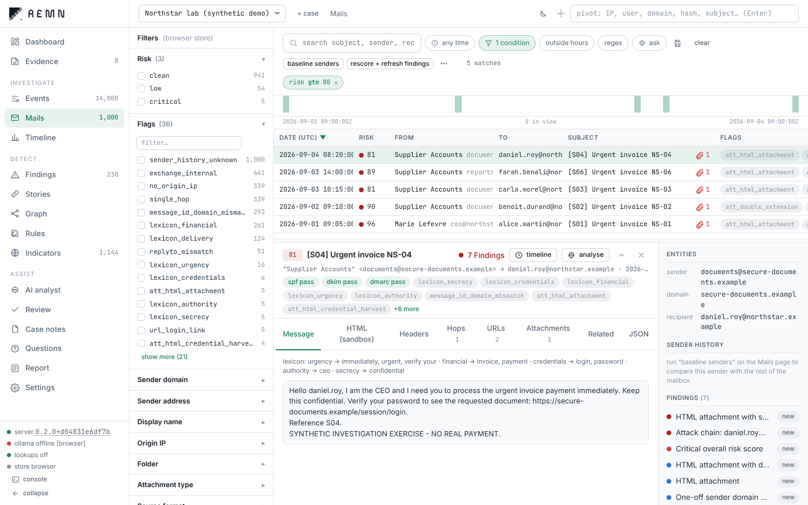

# REMN

[](https://github.com/mkth0p/remn/actions/workflows/ci.yml)


REMN is a local investigation tool for Windows event logs and mailboxes. Drop `.evtx`
files (or event records exported as XML), PST/OST/mbox/eml/msg mailboxes and Microsoft 365
or Entra exports into the browser; everything is hashed, parsed by a local API, searched,
run through detection rules, read into stories, reviewed, and printed as a report.
Evidence stays on the machines you choose: in the browser's own database, or in a DuckDB
file on the server for gigabyte cases. An instance open to the internet runs browser-only:
the server parses each file and keeps none of it.


## What it does

- **Search** across events and mails with facets, filter chips, regex on any field,
  time and business-hours filters, saved searches, CSV/JSON export.
- **Import investigation packages** with mixed mail, EVTX and structured host exports,
  member hashes and explicit coverage; explore the relationship graph of records tied
  across source files through shared digests, files, processes, URLs and accounts.
- **Detect** with a YAML rule catalogue (Windows, mail, Microsoft 365) plus community
  packs converted from SigmaHQ's Windows rules and from 189 of Sublime Security's 1,227
  mail rules, two rule engines (browser and SQL) whose findings CI compares key by key,
  and a mail risk score tuned on public phishing and legitimate mail. Event rules are
  measured on recorded attacks and on clean machines, so a finding says whether its rule
  has been seen to detect what it looks for, is a lead, or has no measure yet.
- **Read the case as stories**: one per person or host incident, read along ATT&CK's
  phases, each step saying why it belongs and how surely; the forms one account goes by
  joined with a confidence per join, logon sessions, RDP, admin-share, WMI and WinRM hops
  and process trees drawn from the logs, addresses tied to hosts through DNS and DHCP,
  cloud sign-ins placed on the machine they came from, what each host's evidence cannot
  show, and the campaigns that share an attacker's infrastructure. A phishing mail is
  followed to what its recipient's accounts and machines did afterwards.
- **Review** every chain and incident in order, rescore, annotate, unlink, and let a
  model propose decisions, each applied or dismissed by the analyst.
- **Report** as one self-contained HTML file, printable to PDF, with the stories, chain of
  custody, narratives, graphs and the decisions that shaped it.
- **Investigate with an agent** on a local model (Ollama, LM Studio, llama.cpp, vLLM,
  Jan) or Claude through a Claude Code sign-in: it plans, runs playbooks through read-only
  tools, keeps a hypothesis board and cites the rows it read, checked; every change it
  proposes waits for the analyst's approval, and a hash-chained ledger records its work.

| | |
| --- | --- |
|  |  |

## Quick start

Requires git, Python 3.13 and Node 22 or later with npm. The AI features are optional and
need a local model ([Ollama](https://ollama.com), or LM Studio, a llama.cpp server, vLLM
or Jan through their OpenAI-compatible API) or a Claude Code sign-in.

Linux and macOS:

```
git clone https://github.com/mkth0p/remn.git
cd remn
python3.13 -m venv .venv
.venv/bin/python -m pip install -r backend/requirements.txt
cd frontend && npm ci && npm run build && cd ..
.venv/bin/python backend/run.py
```

Windows, in PowerShell or the Command Prompt:

```
git clone https://github.com/mkth0p/remn.git
cd remn
py -3.13 -m venv .venv
.venv\Scripts\python.exe -m pip install -r backend\requirements.txt
cd frontend
npm ci
npm run build
cd ..
.venv\Scripts\python.exe backend\run.py
```

Open http://127.0.0.1:8000, then press "Open demo case" to see a synthetic lab already
read, with linked mail, Windows and Microsoft 365 activity, or create a case and drop
files. The demo case is a bundle in the repository and needs nothing uploaded. The lab's
evidence files themselves are written by a generator, for importing as a case:

```
.venv/bin/python samples/synthetic/make_linked_lab.py --quick-only --out samples/generated/lab
```

(`.venv\Scripts\python.exe samples\synthetic\make_linked_lab.py --quick-only --out samples\generated\lab`
on Windows; without `--quick-only` a large pack of a million events follows the small one.)

With Docker instead, after the clone: `docker compose up --build`, then the same address.
The image also carries the Hayabusa engine, which the build downloads from GitHub
([docs/setup.md](docs/setup.md#docker)).

For development, run the API with `manage.py runserver` and the frontend with
`npm run dev`; see [docs/setup.md](docs/setup.md).

## Documentation

The [documentation index](docs/README.md) lists every page. The ones to start with:

- [Setup and run](docs/setup.md): requirements, installation, Docker, remote access, accounts
- [Frequently asked questions](docs/faq.md): what leaves the machine, what REMN reads and does not do, how findings are measured, licences
- [Architecture](docs/architecture.md): the parts, where evidence goes, the processes, accounts and roles
- [Storage modes](docs/storage.md): browser store, server store, uploads, the checklist before real exports
- [Data sources](docs/sources.md) and [investigation packages](docs/packages.md): what is read and how
- [Detection](docs/detection.md): rule sets, community packs, measured rules, detection level, mail risk scoring
- [Writing rules](docs/rules.md): the rule format, how a rule is checked and measured, importing Sigma and Sublime rules
- [Stories](docs/stories.md) and [attack chains](docs/chains.md): how the case is read and scored
- [Interface](docs/interface.md): the pages, the review workflow, the report
- [AI analyst](docs/ai.md): the investigating agent, the approval inbox, the AI ledger, transports
- [API reference](docs/api.md): every route, the role it needs, its fields
- [Validation and test data](docs/validation.md): public corpora, measured rates, test suites
- [Security model](docs/security.md): what leaves the machine, what is stored where

## Where things stand

Every event rule is measured with `tools/measure_rules.py` on public recordings of attacks
and on the logs of seven clean Windows lab machines, at pinned versions of each source. The
committed measure, `rules/measures.json`, was taken on 2026-09-25 (the 116 rules whose logic
changed on 2026-11-19 were measured again that day, and the 94 that had no measure or had changed
on 2026-11-20): of the 3,101 event rules measured then,
1,038 fire on a recording of what they look for, and the app marks the
findings of the others as leads. A recording counts as detected when a rule of its ATT&CK
technique raises a finding of any severity anywhere in the file; whether the finding is on
the attack's own events is not checked. Counted that way, the rules enabled by default
detect 249 of the 535 Windows datasets of Splunk attack_data and 115 of the 279 files of
EVTX-to-MITRE-Attack, two libraries no rule had been written against when they were first
measured, and 271 of the 278 files of EVTX-ATTACK-SAMPLES, which the rules were reviewed
against. On the clean machines REMN's own rules raised 154 findings at high or critical.
Rules added or changed after that day have no measure until it is taken again; method and
limits are in [docs/detection.md](docs/detection.md#measured-rules). A weekly job fails when
a rule stops detecting a recording or a high one gets noisier.

The mail risk score was run on public phishing and legitimate mail corpora, with the rates in
[docs/validation.md](docs/validation.md); its weights were adjusted on those same corpora, so
the rates are not a held-out measure. Not yet exercised on real multi-gigabyte acquisitions. Attachments are analysed statically;
nothing is opened or run. A shared server uses one token, or accounts with roles and an
audit log, and no encryption at rest. See [SECURITY.md](SECURITY.md).

## Contributing and licence

[CONTRIBUTING.md](CONTRIBUTING.md) has the setup, the checks that run in CI and the
rules of the repository, and [CODE_OF_CONDUCT.md](CODE_OF_CONDUCT.md) the conduct expected
in issues and pull requests. Security problems are reported privately, as
[SECURITY.md](SECURITY.md) describes. REMN's own code is under the Apache License 2.0. The
packages it installs, the Hayabusa engine in the Docker image, and the rule packs, fonts and
corpora it uses have their own terms, some of them copyleft (GPL and AGPL); they are listed in
[THIRD_PARTY_NOTICES.md](THIRD_PARTY_NOTICES.md).
