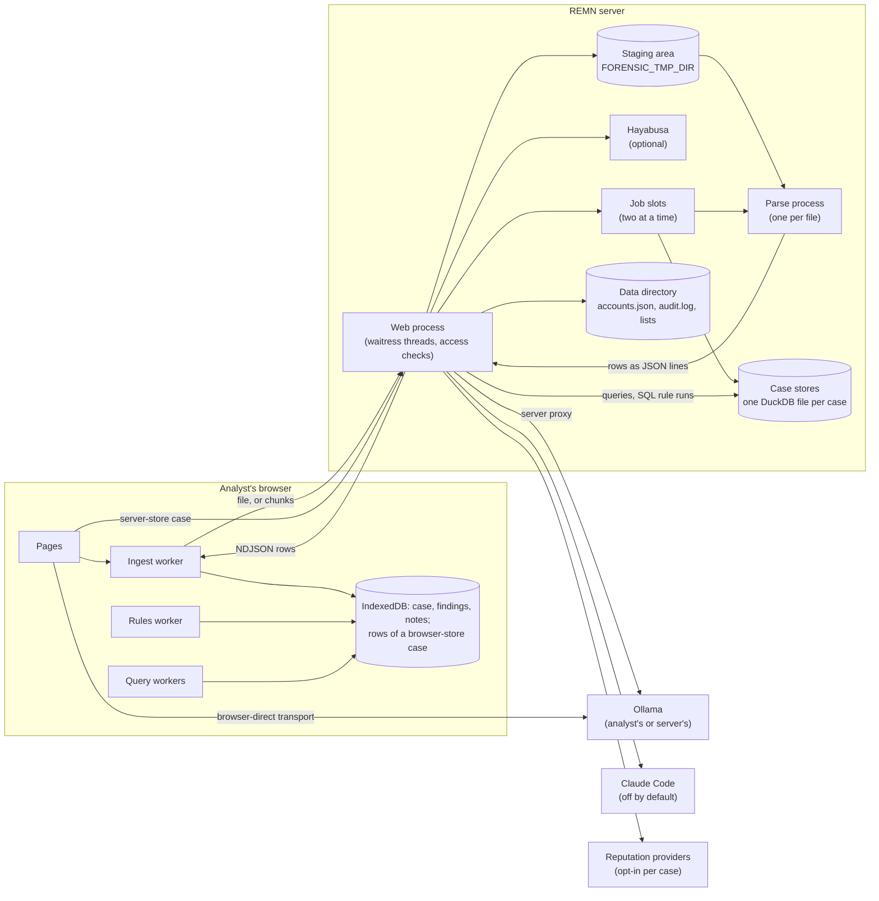

# Architecture

REMN is a browser application and a Python server. The server parses evidence, which takes
libraries a browser does not have (libpff, oletools, the EVTX decoder, YARA), and runs the
heavy work of large cases. The browser keeps the case: its findings, notes, decisions, stories
and AI sessions always, and its evidence rows too unless the case asks the server to keep
them. This page names the parts, shows where evidence goes, and describes the processes, the
accounts and the files on disk. The detail of each part is on the page it links to.

## Components

| Part | Where it runs | What it does | Code |
|---|---|---|---|
| Browser application | the analyst's browser | the pages, the case, the review, the report | `frontend/src/` (React, TypeScript, built with Vite) |
| Browser database | IndexedDB of that browser profile | every case's settings, findings, notes, decisions, AI sessions and ledger; the evidence rows of a browser-store case | `frontend/src/db/schema.ts` (Dexie) |
| Ingest worker | a web worker of the page | hashes each file, sends it to be parsed, reads the rows back and writes them to IndexedDB; can parse an `.evtx` itself with the WebAssembly build of the server's decoder | `frontend/src/workers/ingest.worker.ts`, `frontend/src/parsers/evtx/` |
| Rules worker | a web worker | the browser rule engine | `frontend/src/workers/rules.worker.ts`, `frontend/src/rules/` |
| Query workers | web workers, a few at a time | search, counts, aggregations and timelines over IndexedDB | `frontend/src/workers/query.worker.ts` |
| API server | one Python process (Django served by waitress) | checks every request, parses through the parse process, builds stories, chains and relationships, converts rules, serves the built page | `backend/forensic/`, `backend/api/` |
| Parse process | a child process per parse | reads one uploaded file and sends its rows back | `backend/services/ingest/isolation.py`, `backend/services/parsers/` |
| Jobs | threads of the server process | server-store ingests, rule runs and rescores | `backend/api/jobs.py` |
| Case store | a DuckDB file per server-store case | the evidence rows of that case, queried and run through the SQL rule engine | `backend/services/store/` |
| Hayabusa (optional) | a program the server starts | Sigma rules over event logs, as a third engine | `backend/services/analysis/hayabusa.py` |
| Model (optional) | Ollama on the analyst's machine or the server's machine; the `claude` command line on the server | the AI analyst | `backend/services/ai/`, `frontend/src/ai/` |
| Reputation providers (optional) | third-party services | indicator lookups, when the case allows them | `backend/services/reputation/` |

Three parts exist on both sides and are held to one behaviour by checks CI runs: the rule engine
(browser and SQL, compared finding by finding on `tests/fixtures/parity/`), the EVTX decoder
(the page runs a WebAssembly build of the Rust crate the server's parser uses; CI rebuilds it
from source and fails when it differs from the committed file, and
`frontend/src/parsers/evtx/parity.test.ts` compares its rows with the server's), and the model's
prompts (written in Python, mirrored in the page, checked by
`tests/fixtures/ai_system_compose.json`).

## Where evidence goes



### A browser-store case

The default. The page hashes the file (SHA-256) and sends it to `POST /api/ingest/evtx`,
`/api/ingest/mail` or `/api/ingest/package`, in one request or, above 32 MiB, as a chunked
upload. The server writes it to the staging area, starts a parse process on it, streams the
rows back as NDJSON while they come, and deletes the file when the parse ends, however it ends.
The ingest worker writes the rows to IndexedDB. Rules run in the rules worker, searches in the
query workers; stories, chains and the relationship graph are built by the server from rows
the page posts, and the server keeps none of them. The server never holds the case: after the
parse, the evidence is in that browser profile only.

A case can go one step further: with **parse .evtx files in this browser** on (Settings), an
`.evtx` file is parsed in the ingest worker by the WebAssembly build of the server's decoder and
never leaves the browser. Hayabusa does not run on such a file, since it runs on the server.
Mailboxes, packages and cloud exports are always parsed by the server.

### A server-store case

For cases of gigabytes, a case can keep its rows on the server instead
([Storage modes](storage.md#server-store)). The page uploads each file in chunks
(`/api/upload/...`) and starts a job (`POST /api/store/<key>/ingest`). The job runs a parse
process on the staged file and writes the rows it sends into the case's DuckDB file; the page
follows the job and queries the store through `/api/store/<key>/...`. Rules run on the server as
a job over the store, and the findings come back to the page. Findings, notes, decisions and AI
sessions stay in the browser, as for every case: a member of a shared case sees its evidence
rows, not another member's findings.

| | Browser store | Server store |
|---|---|---|
| Evidence rows | IndexedDB of the analyst's browser | `cases/<key>/case.duckdb` on the server |
| The original file | in the staging area while it is parsed, then deleted (never sent, for an `.evtx` parsed in the browser) | the same |
| Findings, notes, decisions, AI sessions | the browser | the browser |
| Rule engine | browser (rules worker) | SQL (DuckDB), as a job |
| Size it suits | up to a few hundred megabytes | gigabytes |
| Survives | the browser profile; keep a case bundle | the server's disk; back it up with `tools/store_backup.py` |

## Two ways to run the server

**Full** is the default: every route is open, for one analyst on their own machine or for a team
on a server with a token or accounts. **Browser-only** (`FORENSIC_BROWSER_ONLY=1`) is for an
instance open to people you do not know, such as a public demonstration: the server parses and
returns rows and keeps nothing, and the routes that would keep state, reach a third party or run
a model on the server's account (the server store, jobs, reputation, the server-side model
transports) answer 403 `browserOnly`. Every case there is a browser-store case.
`docker-compose.public.yml` is that configuration behind Caddy, with the staging area in memory.
What each mode opens and closes is in the [API reference](api.md#route-index) and the
[security page](security.md#browser-only-mode-and-request-budgets).

## Processes

**The web process.** `backend/run.py` serves the API and the built page with waitress on one
port, 8 worker threads by default (`--threads`). Each request holds a thread for as long as it
runs, and a streamed parse holds one until its last row is sent. Before a view runs, the
middleware checks, in order: the `X-Forensic-Client` header and the token or personal token,
browser-only mode, the per-address request budget, the number of heavy requests in flight, and,
with accounts, what the route declares the account needs (`backend/forensic/settings.py` lists
them). Two background threads run in it: the sweep of abandoned uploads (every
`FORENSIC_UPLOAD_SWEEP_S`, 300 s) and the closing of case stores nobody has used for
`FORENSIC_STORE_IDLE_S` (600 s). The process refuses to start on an address other machines reach
without a token or accounts ([Setup](setup.md#remote-access)).

**The parse process.** Each parse of an uploaded file runs in a child process started for it
from the same interpreter in isolated mode (`python -I`). It gets none of the server's
environment (no token, no provider keys) and only the settings a parser reads. It works in a
folder of its own in the staging area and sends its rows back as JSON lines, which the server
reads as data and never runs. The server stops it at its memory limit (`FORENSIC_PARSE_MAX_MB`,
4096 MiB), its processor time (`FORENSIC_PARSE_MAX_CPU_S`, six hours, not enforced on Windows),
the request's deadline or a cancelled job, keeps the rows read before the stop and says what
stopped it. What each operating system enforces is on the
[security page](security.md#each-parse-in-a-process-of-its-own). Starting it costs about 0.2 s
per file.

**Job slots.** Server-store ingests, rule runs and rescores are jobs: a thread of the server
process each, at most two running at once, the others queued. The parse a job starts is a parse
process like any other, so a job's parse and its writes to the store run on two cores. Jobs are
kept in memory, listed per case, and forgotten when the server restarts; the last 200 finished
ones are kept.

**Hayabusa.** When it is installed, every event log the server parses is also handed to it, as a
separate program under a memory limit (`HAYABUSA_MAX_MB`, 1536 MiB) and a time limit
(`HAYABUSA_MAX_S`, 300 s), one run at a time (`HAYABUSA_CONCURRENCY`). An ingest that waits more
than `HAYABUSA_WAIT_S` (20 s) for its turn goes on without it and says so. See
[Detection](detection.md#external-engines).

**The browser.** The page runs the interface on its main thread and the work in web workers: one
ingest worker per file being imported, the rules worker for a rule run, and a few query workers.
A query whose answer is no longer wanted is stopped where it stands.

## Accounts and roles

Without accounts, a server answers every request that carries the header, and the token when
`FORENSIC_AUTH_TOKEN` is set: one shared token, one user, no record of who did what. That is the
setting for one analyst.

A team on one server creates accounts with `backend/manage.py accounts create <name> --role
admin | analyst | viewer` ([Setup](setup.md#accounts-for-a-team)). From the first account on,
every request carries a personal token, each case records its owner and members, and every
route declares what it needs (the levels are in the [API reference](api.md#what-a-request-needs)):

| Role | May |
|---|---|
| admin | everything, the audit log and the stores no case record covers included |
| analyst | create cases, add and remove evidence, run lookups and enrichment, on the cases it owns or is a member of; change the members of the cases it owns |
| viewer | read the cases it is a member of (search, rule runs, stories, the AI analyst, export), change nothing on the server |

Requests that change something, bring evidence in or take it out, or send it to a model or a
provider, failed sign-ins and refused requests are appended to `audit.log`, each entry chained
to the one before by an HMAC. What the log proves and what it does not is on the
[security page](security.md#accounts-roles-and-the-audit-log).

## Files on disk

The server keeps three folders, each set in `.env`:

```
FORENSIC_DATA_DIR        backend/data by default
  accounts.json          accounts, token digests, case owners and members (with accounts only)
  audit.log, audit.key   the audit log and its key (with accounts only)
  lists/ yara/ geoip/    offline block lists, YARA rules, GeoLite2, which the operator adds
  cases/                 FORENSIC_CASES_DIR, the case stores
    <key>/case.duckdb    one server-store case; <key> is the case's UUID
FORENSIC_TMP_DIR         backend/tmp by default: the staging area
  uploads/               chunked uploads (<id>.part and <id>.json), until parsed or swept
  *.parse/               the folder of one parse process, removed when it ends
```

A case store holds the tables `events`, `mails`, `mail_bodies`, `attachments`, `urls`,
`iocs`, `ioc_reputation`, `evidence` (one row per file added, with its size, both digests, its
row count and its parse statistics) and `meta` (the store's schema version and the record of its
upgrades). Column names are the camelCase keys the browser rows use, so the filter language, the
rules and the model's tools read both stores alike. `GET /api/store/<key>/schema` gives the
columns. The store is not encrypted: on a server it belongs on an encrypted volume
([Security model](security.md#where-evidence-lives)).

In the browser, everything is in one IndexedDB database named `remn` in the browser profile,
with one table per kind of record (`cases`, `evidence`, `events`, `mails`, `mailBodies`,
`attachments`, `urls`, `findings`, `iocs`, `facets`, `caseNotes`, `aiSessions`, `aiLedger` and
others), every row tagged with its case. A case bundle (`.remn.ndjson`) is the portable copy of
one case ([Storage modes](storage.md#portable-case-backups)).

## Repository layout

```
backend/forensic/   settings, middleware (header, token, accounts, budgets), accounts, audit log
backend/api/        URL configuration, views, jobs
backend/services/   parsers, ingest and the parse process, analysis (stories, chains, mail scoring), rules, store, AI, reputation
frontend/src/       pages (views/), components, data access and analysis (data/), rule engine (rules/), workers, EVTX decoder (parsers/evtx/)
rules/              bundled rules, community packs, and the measures of every event rule
tools/              rule measurement, pack import, fixtures, backups, public-corpus validation
tests/backend/      the server's tests; frontend tests sit beside the code they test
samples/synthetic/  generators of the synthetic lab and the test inputs
```
